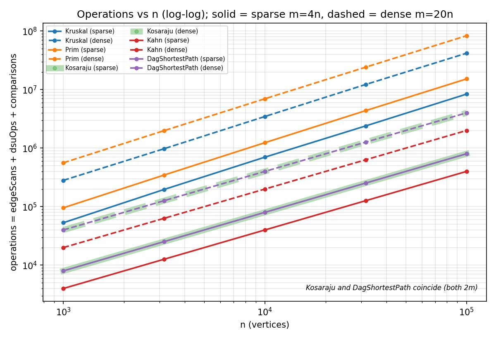
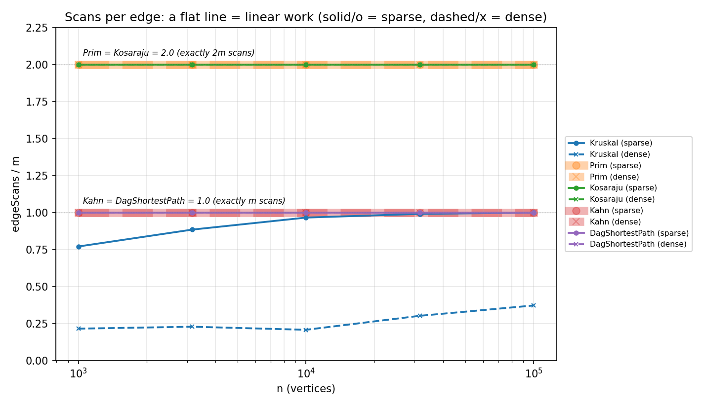
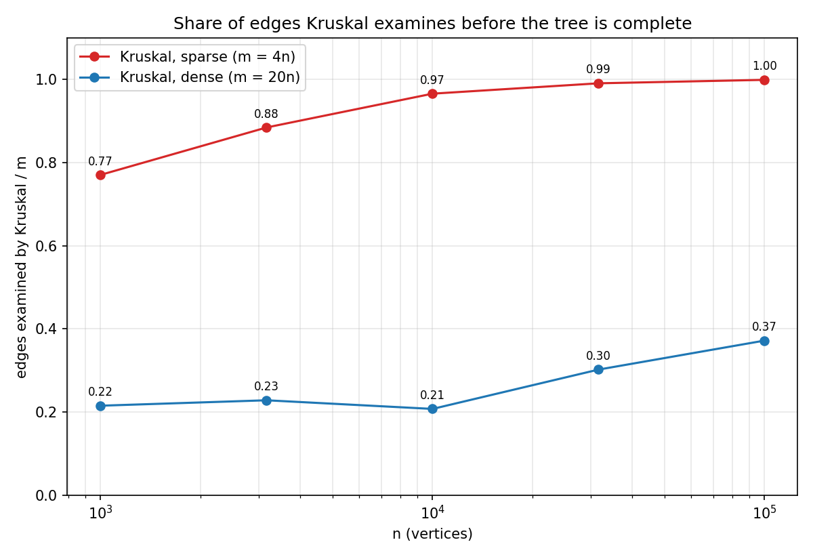

# Assignment 3 - Graphs: DSU, MST, SCC and Shortest Paths

All numbers below come from `results/results.csv` (10 graphs x 5 algorithms = 50 rows) and from
`results/analysis.md`, both produced by `BenchmarkRunner` / `scripts/analyze.py` with `new Random(42)`.
The benchmark reproduces every reference value of the assignment (MST weight, SCC count, sum of DAG distances)
and aborts without writing the CSV if any self-check fails.

Notation: V = n vertices, E = m edges. Sparse: m = 4n, dense: m = 20n.

## 1. Complexity table

| Algorithm | Time | Extra space | Justification |
|---|---|---|---|
| DSU `find` / `union` | O(alpha(n)) amortised | O(n) | union by rank keeps trees at depth <= log n, path compression flattens them further; alpha(n) <= 4 for any practical n. `find` is iterative. |
| Kruskal | O(E log E) = O(E log V) | O(E + V) | sorting the E edges dominates (counted: 0.90 - 0.95 * E log2 E comparisons); then at most E DSU operations at O(alpha(V)) each. Extra: sorted copy of the edge list, DSU, tree. |
| Prim (lazy, `PriorityQueue`) | O(E log E) = O(E log V) | O(E + V) | every adjacency entry is scanned once (2E) and each pushes at most one heap entry (<= 2E heap operations at O(log E)). Stale entries are skipped when polled. |
| Kosaraju | O(V + E) | O(V + E) | two DFS passes, each scans every edge once (2E scans); the reversed graph (CSR arrays), finish order and the explicit stack are O(V + E). |
| Kahn | O(V + E) | O(V) | in-degree array + queue; every edge is looked at once when its tail leaves the queue (E scans). |
| DAG shortest paths | O(V + E) | O(V) | one pass over the topological order, every edge relaxed once (E scans, E comparisons); `dist[]` and `parent[]`. The order itself costs one Kahn run. |
| *(bonus)* Tarjan | O(V + E) | O(V) | one DFS pass (E scans), `index[]`, `lowlink[]`, stack of active vertices. |

## 2. Counters versus formulas

If the complexity class is right, `counter / formula` must stay constant when n grows (n = 1 000 ... 100 000, a factor of 100).

**Sparse graphs (m = 4n)**

| algorithm | ratio | n=1000 | n=3162 | n=10000 | n=31623 | n=100000 |
|---|---|---|---|---|---|---|
| Kruskal | dsuOps / edgeScans | 2.324 | 2.283 | 2.259 | 2.252 | 2.250 |
| Kruskal | comparisons / (E log2 E) | 0.896 | 0.928 | 0.940 | 0.926 | 0.949 |
| Prim | comparisons / (E log2 V) | 2.196 | 2.186 | 2.180 | 2.178 | 2.167 |
| Kosaraju | edgeScans / (V + E) | 1.600 | 1.600 | 1.600 | 1.600 | 1.600 |
| Kahn | edgeScans / (V + E) | 0.800 | 0.800 | 0.800 | 0.800 | 0.800 |
| DagShortestPath | edgeScans / (V + E) | 0.800 | 0.800 | 0.800 | 0.800 | 0.800 |

**Dense graphs (m = 20n)**

| algorithm | ratio | n=1000 | n=3162 | n=10000 | n=31623 | n=100000 |
|---|---|---|---|---|---|---|
| Kruskal | dsuOps / edgeScans | 2.232 | 2.219 | 2.241 | 2.166 | 2.134 |
| Kruskal | comparisons / (E log2 E) | 0.935 | 0.922 | 0.946 | 0.953 | 0.942 |
| Prim | comparisons / (E log2 V) | 2.616 | 2.533 | 2.473 | 2.421 | 2.381 |
| Kosaraju | edgeScans / (V + E) | 1.905 | 1.905 | 1.905 | 1.905 | 1.905 |
| Kahn | edgeScans / (V + E) | 0.952 | 0.952 | 0.952 | 0.952 | 0.952 |
| DagShortestPath | edgeScans / (V + E) | 0.952 | 0.952 | 0.952 | 0.952 | 0.952 |

Reading the table:

* **Traversals are exactly linear.** Kosaraju scans exactly 2E edges, Kahn and the DAG relaxation exactly E, at every size
  and density (the ratio against V + E is constant: 2E/(V+E) = 1.6 sparse, 1.905 dense). Prim scans exactly 2E adjacency entries.
* **Kruskal.** The sort costs 0.90 - 0.95 * E log2 E comparisons at every size - the E log E term is confirmed.
  Raw `dsuOps / E` is *not* flat on dense graphs (0.48 -> 0.79) because Kruskal stops as soon as it has V - 1 tree edges,
  so it examines fewer than E edges (Section 5). Against the edges it really examines the cost is constant:
  `dsuOps ~ 2 * edgeScans + (V - 1)` (two finds per examined edge plus one successful union per tree edge), i.e. about 2.1 - 2.3.
* **Prim.** Heap comparisons per `E log2 V` are constant to within 1 % (sparse) and 10 % (dense); the small drift on dense graphs
  is the lower-order term of the heap work, not a change of complexity class.

## 3. Slope check (log-log, fit over the five sizes)

| algorithm | slope of edgeScans, sparse | slope of edgeScans, dense | slope of total operations, sparse | dense |
|---|---|---|---|---|
| Kosaraju | **1.000** | **1.000** | 1.000 | 1.000 |
| Kahn | **1.000** | **1.000** | 1.000 | 1.000 |
| DagShortestPath | **1.000** | **1.000** | 1.000 | 1.000 |
| Prim | 1.000 | 1.000 | 1.101 | 1.085 |
| Kruskal | **1.055** | **1.119** | 1.096 | 1.088 |

All traversals have slope 1.000, i.e. linear work. Kruskal is steeper, as expected. Two things contribute and the counters
separate them: its *total* operations grow like E log E (the sort), giving a slope of about 1.09; and its *edgeScans* grow
faster than n because the prefix of the sorted edge list must become connected, which for random weights happens after
roughly n log n edges, so the examined share rises with n (Section 5). Prim's total-operation slope (1.09 - 1.10) is the
same log factor from the heap.

## 4. Correctness arguments

**Cut property (Kruskal and Prim).** Let A be a set of edges contained in some minimum spanning tree T, and let (S, V\S) be a cut
that no edge of A crosses. Claim: a lightest edge e = (u, v) crossing the cut can be added to A safely. If e is in T we are done.
Otherwise T + e contains exactly one cycle; it passes through e, so it must cross the cut a second time at some edge f in T,
and f is not in A because A does not cross the cut. Since e is lightest across the cut, w(e) <= w(f), so T' = T - f + e is a spanning
tree with w(T') <= w(T); hence T' is also minimum and contains A + e. **Kruskal:** when it examines an edge e = (u, v) whose ends lie
in different components of the current forest A, take S = the component of u. No edge of A crosses this cut, and every edge lighter than
e that crossed it would already have been processed and would have merged the two components - so e is a lightest crossing edge and is
safe; edges with both ends in the same component are skipped because they would close a cycle. **Prim:** S = the vertices already in the tree.
Tree edges lie inside S, so the cut respects A, and the smallest non-stale entry of the priority queue is the lightest edge leaving S;
entries whose far end is already in S are skipped. With equal weights either of several lightest edges is safe, which is why the trees may
differ while the total weight is the same - the benchmark checks exactly this.

**Induction on the topological order (DAG shortest paths).** Let d*(v) be the true shortest distance to v from the set of sources
(in-degree-0 vertices, all starting at 0). Claim: when v is taken from the topological order, dist[v] = d*(v), and dist[v] never changes afterwards.
Every value stored in dist[] is the length of a real path, so dist[v] >= d*(v) always; we must show dist[v] <= d*(v) at the moment v is processed.
Base: the first vertex of a topological order has no incoming edge, so it is a source and d* = dist = 0.
Step: assume the claim for all vertices before v. If v is a source it has no incoming edge and dist[v] = 0 = d*(v). Otherwise a shortest path
to v ends with some edge (p, v); p precedes v in the order, so by the hypothesis dist[p] = d*(p), and when p was processed it relaxed (p, v),
giving dist[v] <= d*(p) + w(p, v) = d*(v). Later vertices cannot have an edge into v (they come after it in the order), so dist[v] is never touched again.
One pass is therefore enough, and O(V + E) in total.

**Why negative weights are safe in a DAG but not in a general graph.** The induction never uses w >= 0: it only uses that all predecessors of a
vertex are final before the vertex is processed, which the topological order guarantees. Dijkstra, in contrast, *finalises* the closest unfinished
vertex, which is only correct if later edges cannot make it shorter - false with a negative edge. In a general graph there is no topological order, and
a cycle of negative total weight makes "the shortest path" undefined (each lap lowers the distance), so such graphs need Bellman-Ford (O(VE)) and a
negative-cycle test. A DAG has no cycles at all, so neither problem can occur.

## 5. Which algorithm when

| Situation | Choice | Why (evidence) |
|---|---|---|
| MST, sparse graph (E ~ 4V), edges available as a list | **Kruskal** | sort + DSU; in our runs Prim needed 1.8x more total operations (Prim / Kruskal ops 1.76 - 1.83). It examines almost all edges here (99.9 % at n = 100 000), but that is only 4V edges. |
| MST, dense graph (E ~ 20V), edges as a list | **Kruskal** | early exit after V - 1 tree edges: only 21 - 37 % of the edges are examined; Prim always scans all 2E adjacency entries. Prim / Kruskal ops = 1.98 - 2.04. |
| MST of a very dense / complete or implicit graph (E ~ V^2, no edge list, weights computed on demand) | **Prim** with an O(V^2) array instead of a heap | no need to materialise and sort V^2 edges. *(Theory; not implemented or measured here - lazy heap Prim as implemented never beat Kruskal in our counters.)* |
| MST, graph already stored as an adjacency list, tree wanted from a given root | **Prim** | works directly on adjacency lists; grows from vertex 0. |
| Graph may be disconnected | either | both return a minimum spanning forest; Kruskal reads the component count from the DSU, Prim restarts from each unvisited vertex. |
| Directed graph, find deadlocks (cycles) | **Tarjan** (or Kosaraju) | Tarjan: one pass, m edge scans and no reversed graph; Kosaraju: 2m scans + O(E) memory for the reverse, but simpler to explain. |
| Order dependent jobs, a cycle is possible | **Kahn** | cycle is reported when fewer than n vertices leave the queue; iterative, E scans. |
| Fastest route through an acyclic pipeline, any weights | **DAG relaxation** | O(V + E), negative weights allowed, super-source removes the "which start?" question. Dijkstra (O((V+E) log V)) is unnecessary. |
| Shortest paths with cycles, weights >= 0 / with negative weights | Dijkstra / Bellman-Ford | not part of this assignment; the DAG method does not apply. |
| Data format | Kruskal wants an edge list; Prim, Kosaraju, Tarjan, Kahn and DAG paths want adjacency lists | this is why `Graph` keeps both. |

**Plots.** Operations vs n (log-log), scans per edge, and the share of edges Kruskal examines:

*Plot 2:* Kosaraju is flat at 2.0, Prim flat at 2.0, Kahn and the DAG pass flat at 1.0 - the confirmation of linear work. Kruskal rises with n.
*Plot 3:* on sparse graphs Kruskal examines 0.77 -> 0.999 of the edges (it needs almost all of them to connect the graph); on dense graphs only
0.21 -> 0.37. This is where each MST algorithm wins: Kruskal profits from dense graphs because it can stop early, while the cost of lazy Prim is fixed at 2E scans.

## 6. Bonus tasks

**A. Tarjan.** `TarjanSCC` returns the same partition as Kosaraju on every test and benchmark graph (checked automatically) and scans
exactly E edges versus 2E for Kosaraju - ratio 0.50 on all ten graphs. The saving comes from there being only one DFS: Kosaraju needs a second traversal
over the reversed graph just to separate the components, while Tarjan identifies a component root (`lowlink == index`) during the first pass and
pops the component off its stack; it also needs no reversed graph in memory. On the large sparse graph: 800 000 scans vs 400 000.

**B. Condensation and critical path.** `Condensation` collapses every SCC into one vertex; the result is always a DAG (verified with Kahn on
every benchmark graph), because a cycle among components would force them to be one component. `CriticalPath` negates the weights and runs
the same one-pass relaxation. For the sparse graphs the longest path of the condensation has length 3 053, 2 992, 3 779, 3 952 and 4 977 for
n = 1 000 ... 100 000; the dense graphs are one giant SCC, so their condensation is a single vertex (length 0). The longest path is easy in a DAG for the
same reason as the shortest path (a topological order makes one pass enough); in a general graph the longest *simple* path is NP-hard (it contains the
Hamiltonian path problem) and with a positive cycle the longest walk is unbounded. In scheduling the critical path is the chain of dependent jobs that sets the
minimum project duration (CPM / PERT): delaying any job on it delays the whole project, jobs off it have slack.

## 7. Time

Median-of-5 wall-clock times are in the CSV, e.g. at n = 100 000 / m = 2 000 000: Kruskal about 1.07 s, Prim 2.55 s, Kosaraju 0.32 s, Kahn 0.08 s,
DAG paths 0.08 s (single-core container, JDK 21). At the two smallest sizes the clock is mostly noise: Kosaraju took 6.6 ms at n = 1 000 but only 1.0 ms at
n = 3 162 - the JVM was still compiling the code (JIT warm-up). Times depend on the CPU, the JVM version, the garbage collector and background load, so they are
*not* the evidence of this report; a different laptop will show different numbers (and possibly a different Kruskal/Prim gap), while the operation counters are
identical everywhere because they are counted inside the algorithms with a fixed seed. All conclusions above are drawn from the counters.
